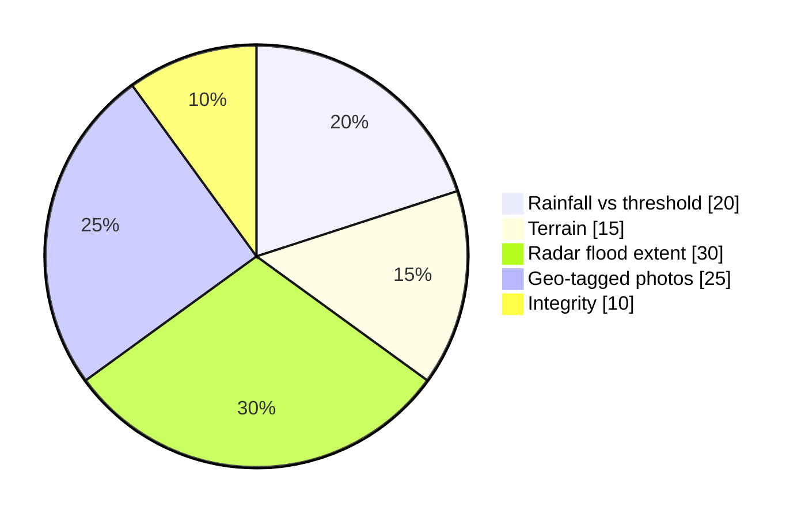
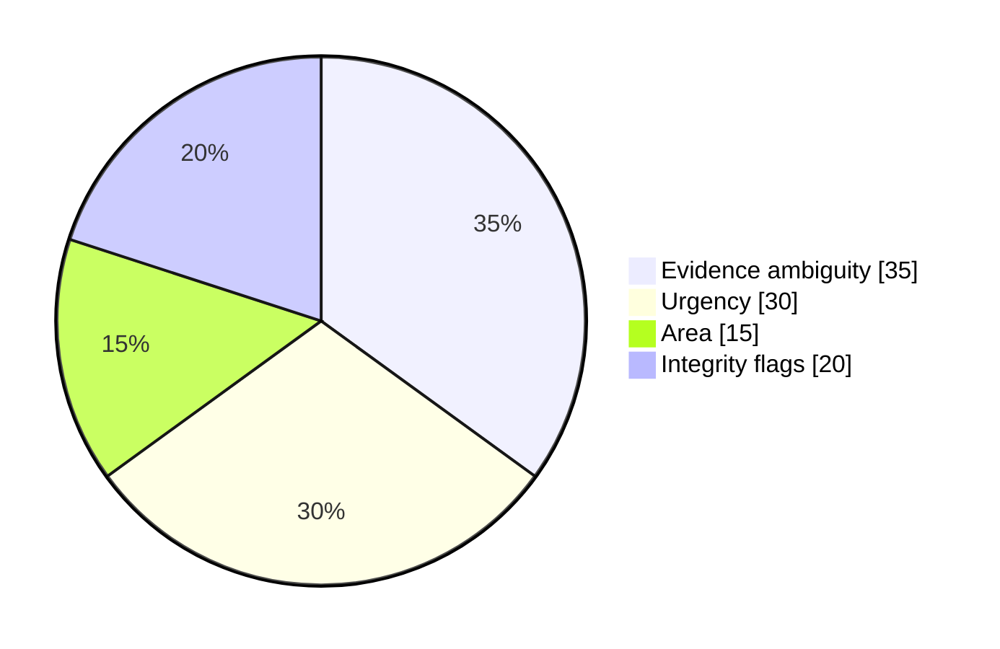

# What is Saboot and how does it work? {#saboot-overview}

Saboot is a front-end-only simulation of a **disaster crop-loss evidence layer**. Rules start an evidence clock at the storm, the farmer's phone seals photos so tampering shows, and an officer console ranks plots for review. It never decides a claim.

- Three pure rules (rain, radar, river) decide when an event starts, and the earliest signal wins.
- Each farmer's photos are sealed in a SHA-256 hash chain on the phone, and a signed code can carry the seal to a laptop.
- The officer sees a tier and a priority with uncertainty, never a claim decision.
- All data is synthetic from one seeded replay, and the site works offline after one visit.

@answer scope="saboot-clean at ff4d148 · static app, synthetic data · read from source, not run"
@meta locale=en
@source readme title="README: what Saboot is" path=README.md lines=1:16
@source spec title="Spec section 15: rules and evidence parameters" path=docs/SABOOT-SPEC.md lines=296:326
@source gen title="Scenario generator (seed 20260714)" path=scripts/gen-scenario.ts lines=1:12
@source engine title="Simulation engine and clock" path=src/sim/engine.ts lines=1:21
@source rules title="Rules A, B, C and combine" path=src/sim/rules.ts lines=128:172
@source model title="detect: rules applied to a plot" path=src/sim/model.ts lines=286:310
@source evidence title="Evidence weights and tier thresholds" path=src/sim/evidence.ts lines=32:57
@source priority title="Inspection priority formula" path=src/sim/evidence.ts lines=167:199
@source hash title="Hash chain and canonical JSON" path=src/lib/hash.ts lines=66:106
@source focus title="Capture, seal and sync on the phone" path=src/farmer/focus.ts lines=263:380
@source db title="IndexedDB wrapper" path=src/lib/db.ts lines=1:3
@source payload title="Signed packet layout (feature K)" path=src/k/payload.ts lines=1:9
@source ledger title="District audit ledger and tamper test" path=src/sim/ledger.ts lines=1:3
@source config title="Rails and scenario parameters" path=src/config.ts lines=16:59
@source sw title="Cache-first service worker generator" path=scripts/sw.mjs lines=1:5
@source post title="Postbuild: prerender, social tags, CSP, worker" path=scripts/postbuild.mjs lines=1:4

## What does Saboot do, and what does it refuse to do? {#purpose}

@facts id=purpose-facts
| Problem | After a flood, field evidence fades as water recedes, while assessment needs officers to reach every field. |
| Idea | Watch simulated rain, river and radar signals, start a clock at the event, and guide sealed photo capture in the farmer's language. |
| Output | A ranked worklist and a draft assessment list that say why each plot sits where it does. |
| Stack | Vite, Preact, Preact signals and TypeScript, with no backend and no UI kit. |
| Context | Built for the Code Yudh Hackathon, AgriTech and Agri-FinTech track. |

@callout id=purpose-limits level=warning title="Saboot assembles evidence and never decides"
Deterministic rules own detection and timing. AI is limited to perception and language.
Nothing files a claim, places a real call or reaches a government system. The decision happens outside Saboot.

## How are the parts connected? {#architecture}

@architecture id=system-map title="Saboot runtime map"
| scenario | Seeded scenario | database | source:gen |
| engine | Engine and model | backend | source:engine |
| rules | Rules A B C | backend | source:rules |
| farmer | Farmer app | frontend |
| idb | Phone log | database | source:db |
| officer | Officer console | frontend |
| ledger | Audit ledger | security | source:ledger |
| verifier | Packet verifier | external |
| worker | Service worker | cloud | source:sw |
| scenario > engine | fetched |
| engine > rules | calls |
| engine > farmer | alert |
| engine > officer | rows |
| farmer > idb | chained log | emphasis |
| farmer > officer | signed code | security |
| farmer > verifier | same code | dashed |
| officer > ledger | events |
| worker > farmer | offline | dashed |

@steps id=architecture-steps
| scenario | Seeded scenario | Built by `scripts/gen-scenario.ts` with a seeded random generator, so every run writes the same replay file. | system-map | scenario |
| engine | Engine and model | Runs a seven-day replay clock and rebuilds the model when the rail or radar cadence changes. | system-map | engine |
| rules | Rules A B C | Plain functions of numbers, shared by the app and the real-data validation harness. | system-map | rules |
| idb | Phone log | One hash-chained log per farmer. Photos stay here, and only fingerprints travel. | system-map | idb |
| officer | Officer console | Scores and ranks every plot, and imports signed packets from a phone by QR, paste or link. | system-map | officer |
| ledger | Audit ledger | Every cohort event in one append-only chain, with a verify button and a tamper test. | system-map | ledger |

## How does a flood start the evidence clock? {#detection}

@workflow id=detection-flow title="From signals to a voice alert"
| rain | Rule A rain | backend |
| radar | Rule B radar | backend |
| river | Rule C river | backend |
| fired | Any rule fired? | backend |
| detect | Detection time | backend |
| clock | Event clock start | backend |
| call | Voice alert | frontend |
| watch | Keep watching | external |
| rain > fired | |
| radar > fired | |
| river > fired | |
| fired > detect | yes | emphasis |
| fired > watch | no | dashed |
| detect > clock | earliest signal |
| clock > call | plus 0.25 h |

| Rule | Fires when | Event clock starts at | Version |
| --- | --- | --- | --- |
| A: rain on low land | 24-hour rain at the nearest gauge reaches the heavy-rain line on a low-lying plot | First time that gauge crossed the lower rain line | 1 |
| B: radar change | Radar water above the crop's usual water reaches the flood share | Last clear radar pass | 2 |
| C: river or dam | An upstream or adjacent gauge reaches danger level and the flood wave can reach the plot in time | Gauge crossing time | 1 |

@callout id=detection-conservative level=note title="When unsure, the farmer gets less time"
Detection is the earliest rule to fire. The clock starts at the earliest qualifying signal before it, never later.
Paddy in the standing-water season is expected to look wet, so only water above that level counts. This is an unvalidated design decision.
Confidence is high when two rules fired, low when only radar fired on a wet crop, and medium otherwise.

## What happens on the phone between photo and server? {#capture}

@sequence id=capture-flow title="Capture, seal and sync"
| actor farmer | Farmer or helper | external |
| actor app | Phone app | frontend |
| actor idb | IndexedDB | database |
| actor server | Simulated server | backend |
| phase | Capture |
| farmer | app | Take guided photo |
| app | idb | Photo blob and shot link |
| app | idb | Outbox entry if weak or offline | dashed |
| phase | Seal |
| farmer | app | Seal packet |
| app | idb | Seal link with packet hash |
| phase | Sync |
| app | idb | Read outbox |
| app | server | Fingerprints first, bodies later |
| server | app | Receipt time stamped | return |
| app | idb | Sync link appended |

@callout id=capture-chain level=note title="How the chain works"
Each link is SHA-256 of the previous hash plus the canonical JSON of its body, and the first link follows 64 zeros.
Editing any stored record breaks that link and every later one, which the ledger tamper test shows on screen.
On a weak network each fingerprint goes alone about every 1.2 seconds, and it fixes the server receipt time before any photo body moves.
A gap of more than 2 hours between phone time and server time is flagged for review.

## How are plots scored and ranked? {#scoring}

| Case | What changes |
| --- | --- |
| Plot the river can reach | A river factor takes 0.10, and the other five weights are scaled to 0.90 {good:Sum stays 1} |
| Paddy in standing-water season | Radar keeps 0.4 of its weight, then all weights are renormalised, and its uncertainty widens {caution:Unvalidated} |
| Tier rule | Supported needs the whole uncertainty band at or above 0.60, and insufficient needs it all below 0.45 |
| Hail | A low-confidence prompt, capped at partial, and a plot that never replies is unconfirmed, not missed |

Weights are scenario parameters, not fitted to any claims data. The priority formula is pinned by a unit test against the original build.

## How does evidence travel from phone to laptop? {#packet-transfer}

@steps id=packet-steps
| seal | Seal on the phone | After sealing, the Proof screen offers Share as a QR code. The packet becomes one signed code. |
| carry | Carry the code | It is a QR code, a copyable code, or a link whose `#k=` fragment never reaches a server. |
| import | Import on the laptop | The officer console scans with the webcam, accepts a pasted code, or opens the link. |
| verify | Recompute and verify | The console rebuilds the chain from the shot records and checks the ECDSA P-256 signature. |
| show | Show the result | A pass reads: integrity verified, not altered since sealing. The plot appears as Imported (live). |

@facts id=packet-layout
| Header | Version, plot number, event and seal times, phone clock, location rounded to about 100 m, shot count: 19 bytes |
| Per photo | Kind, replay time and SHA-256: 35 bytes each, 3 photos = 105 bytes |
| Trailer | Chain head 32 bytes, compressed public key 33 bytes, signature 64 bytes |
| Size | 19 + 105 + 129 = 253 bytes, about 338 base64url characters |

@callout id=packet-proves level=warning title="What a verified packet does and does not prove"
It proves the packet was not altered after sealing. It does not prove who sealed it, that the photos are true, or that the phone clock was right.
The helper name and consent text travel in an unsigned context block in format version 1.
A standalone script, `scripts/verify-packet.mjs`, checks the same format with no Saboot imports, and ten test vectors must give the same answer in both verifiers.

## How do the two rails differ? {#rails}

| Aspect | Relief (primary, default) | Crop insurance (second) |
| --- | --- | --- |
| Supports | A state or district revenue assessment of flood losses | The 72-hour intimation of a localized calamity |
| The window | Advice of 48 hours, "capture soon", never red {good:Not a deadline} | A rule of 72 hours, red once passed {caution:Hard deadline} |
| Who acknowledges | The officer | The insurer |
| State named | None | A fictional district in Haryana, marked to confirm Haryana runs the scheme |
| Amounts | None anywhere | None anywhere |

The rail changes words, windows and actors. It does not change detection, event times, capture, sealing, tiers or priority, and a test pins identical detections on both.

## What is real and what is simulated? {#real}

| Part | In this demo | Status |
| --- | --- | --- |
| Rain, river and radar data | Synthetic series from one seeded replay: 3 rain gauges, 2 river or dam gauges | {caution:Simulated} |
| Event rules and clocks | Real code running in the browser | {good:Real} |
| Detection accuracy | A consistency check against the generator's own flood | {bad:Not validation} |
| Hash chain and signatures | WebCrypto SHA-256 and ECDSA P-256 | {good:Real} |
| Offline queue and sync | Real IndexedDB queue and service worker, simulated server | {caution:Partly real} |
| Camera and location | Real phone camera and GPS, simulated fallback | {good:Real} |
| Voice alert | Real audio or speech synthesis, no call placed | {caution:Partly real} |
| Draft list, objections, acknowledgements | Scripted timings, real export | {caution:Simulated} |
| Pilot metrics | Computed from the synthetic replay | {caution:Simulated} |

## Where does everything live in the repo? {#layout}

@tree id=repo-layout title="Repository layout"
| root | saboot | - |
| src | src | root |
| site | site: page shell | src |
| farmer | farmer: phone app and helper mode | src |
| dashboard | dashboard: officer console | src |
| sim | sim: model, rules, evidence | src |
| k | k: signed packet and QR | src |
| lib | lib: hash, db, voice, prefs | src |
| i18n | i18n: en, hi, pa | src |
| scripts | scripts: build and gates | root |
| docs | docs: spec and pilot kit | root |
| tests | tests: unit and Playwright | root |
| public | public: data, fonts, audio | root |

## How is it built, tested and shipped? {#shipping}

@steps id=ship-steps
| ship-gen | Generate the scenario | Run `npm run gen` to write the replay, a TypeScript summary and the docs facts. |
| ship-build | Build and postbuild | Vite builds, then the postbuild step prerenders the shell, adds social tags, hashes inline scripts into the CSP and writes the service worker. |
| ship-verify | Run every gate | Run `npm run verify`: types, lint, unit tests, i18n parity, contrast, size budgets, Playwright with axe, and Lighthouse. |
| ship-deploy | Deploy by hand | Run `npm run deploy`. It refuses while a gate fails or any real-world claim marker remains. |

| Budget | Limit | README reports |
| --- | --- | --- |
| Initial load, gzip | 200 KB | 87.3 KB {good:Within} |
| Whole site excluding audio, gzip | 700 KB | 389.6 KB {good:Within} |
| Largest lazy chunk, gzip | 60 KB | 45.3 KB {good:Within} |
| Lighthouse mobile: performance, accessibility, best practices | 90, 95, 95 | 97, 100, 100 |

## What are the limits, and what should you check? {#limits}

- [ ] Treat precision 0.67 and recall 1 as a consistency check only: the river series comes from the same simulated flood.
- [ ] Before any real use, run `npm run validate:real` on real rainfall, river and confirmed-village files.
- [ ] Before deploying, set `PUBLIC_URL` and the team name in `src/config.ts` and resolve each real-world claim marker.
- [ ] Have a native speaker review the Hindi and Punjabi strings and the consent sentence, and have counsel review the privacy design.
- [ ] Remember that the server is simulated in the browser, so state is per browser and the reset key clears it.
