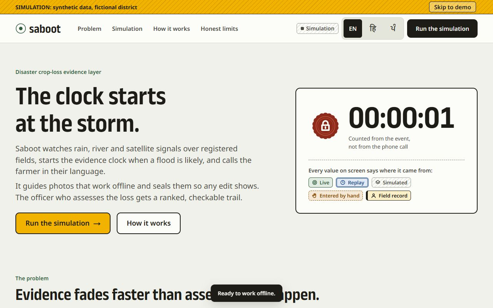

# Saboot — the clock starts at the storm

[](https://github.com/Lucifer0000007/Saboot/actions/workflows/ci.yml)

**SIMULATION · synthetic data · fictional district.** Saboot is a front-end-only simulation of a **disaster crop-loss
evidence layer**. After a flood, evidence of crop loss fades as the water recedes, while assessment depends on officers
reaching every field. Saboot watches (simulated) rain, river and satellite signals, starts an evidence clock at the
**event**, calls the farmer in their language, guides sealed photo evidence that works offline (with a helper, for the farmers
who need one), and gives the officer a ranked worklist and a draft assessment list that say why each plot is where it is.

It runs on **two rails over one core**. The **relief rail** (primary) supports a state or district revenue assessment of flood
losses: no state is named, no amount is shown, and the "capture soon" window is advice, not a deadline. The **crop-insurance
rail** (second) supports the 72-hour intimation of a localized calamity, in a fictional district of a state that runs the scheme.
The rail changes wording, windows and actors. It does not change detection, capture, sealing or ranking.

Saboot **assembles evidence and never decides claims**. Deterministic rules own detection and timing; "AI" is only perception and
language; every score shows its uncertainty; every number on screen comes from the simulation and says so. Nothing here files a
claim, places a real call, or connects to any government system. The decision happens outside Saboot.

Built for the Code Yudh Hackathon, Chandigarh University · Track: AgriTech & Rural Transformation · Agri-FinTech.
Spec: [`docs/SABOOT-SPEC.md`](docs/SABOOT-SPEC.md) (§14–15 hold the two-rail design and the rules) · design: [`docs/DESIGN.md`](docs/DESIGN.md) · what is not built: [`docs/ROADMAP.md`](docs/ROADMAP.md) · rules for contributors: [`CONTRIBUTING.md`](CONTRIBUTING.md) and [`CLAUDE.md`](CLAUDE.md) · security: [`SECURITY.md`](SECURITY.md).

**Live site:** https://moonlit-pixie-248afc.netlify.app (this is the `PUBLIC_URL` in
[`src/config.ts`](src/config.ts), which also feeds the canonical link, the social preview tags and the judges' QR code).



Run it locally in one line: `npm ci && npm run dev` (then open http://localhost:5173).

## What is in the box

| | Where |
|---|---|
| The simulation: farmer app, officer console, audit ledger, detection explainer | this repository, `src/` |
| Relief workflow: worklist, draft list, objections, pilot metrics | the **Officer** tab, relief rail |
| Helper mode and the feature-phone design simulation | the farmer app home |
| Real-data validation harness (not yet run on real data) | [`docs/VALIDATION.md`](docs/VALIDATION.md) |
| Open evidence format and a standalone verifier | [`docs/EVIDENCE-FORMAT.md`](docs/EVIDENCE-FORMAT.md) |
| Privacy and consent design (not legally reviewed) | [`docs/PRIVACY-AND-CONSENT.md`](docs/PRIVACY-AND-CONSENT.md) |
| Pilot kit | [`PILOT-PLAN`](docs/PILOT-PLAN.md) · [`BUYER-ONE-PAGER`](docs/BUYER-ONE-PAGER.md) · [`EXISTING-SOLUTIONS`](docs/EXISTING-SOLUTIONS.md) · [`STAKEHOLDER-INTERVIEW-GUIDE`](docs/STAKEHOLDER-INTERVIEW-GUIDE.md) · [`LETTER-OF-SUPPORT-TEMPLATE`](docs/LETTER-OF-SUPPORT-TEMPLATE.md) |
| Every scenario number the docs quote | [`docs/SCENARIO-FACTS.md`](docs/SCENARIO-FACTS.md), written by `npm run gen` |

## Quick start

```bash
npm install
npm run dev                       # http://localhost:5173
npm run build && npm run preview  # production build on http://localhost:4173
npm run verify                    # every quality gate (≈ 15 min); --quick for the fast loop
```

Needs Node 24 (`engines` in `package.json`; `netlify.toml` and the Pages workflow pin the same major) and Google Chrome
(QA and Lighthouse drive the installed Chrome). `npm run fonts` additionally needs Python with `fonttools` and
`brotli`. On Windows, shell scripts run through Git Bash (`scripts/run-sh.mjs` finds it).

## Deploy (you run this — nothing deploys automatically)

The site is fully static (`dist/`). The deploy script refuses to publish while any gate fails or any
`{{VERIFY}}` marker remains (see [Real-world claims to verify](#real-world-claims-to-verify-before-deploying)).

```bash
npx netlify-cli login                          # opens the browser once
npx netlify-cli sites:create --name saboot     # or saboot-demo / saboot-72h if taken; or: npx netlify-cli link
npm run deploy                                 # verify → markers --strict → netlify deploy --prod --dir dist
```

`--prod` publishes the site **publicly** at `https://<name>.netlify.app`. Before that, set `PUBLIC_URL` in
`src/config.ts` to that address and delete its marker: the build writes it into the canonical link and the Open
Graph / Twitter tags, and `npm run qr` encodes it, so the three can never disagree. Netlify is the primary host;
`.github/workflows/pages.yml` is a manual backup (it runs only from the Actions tab, never on push). Any static host
works the same way (Vercel, Cloudflare Pages: publish `dist/`).

**How the live site gets updated.** The live site (`moonlit-pixie-248afc`) is linked to this repository in Netlify:
**every merge to `main` builds and publishes it to production**, and a pull request gets a deploy preview (which needs a
Netlify login to open). Netlify runs `npm run build` only; the tests run in CI (`.github/workflows/ci.yml`)
and locally (`npm run verify`), so run them before merging. `npm run deploy` is a different path: it publishes this clone's
linked Netlify site by hand, after the full gate.

**HTTP headers** are defined once, in `public/_headers` (`netlify.toml` holds build settings only): a Content
Security Policy with no `unsafe-inline` scripts (the build hashes the three inline scripts), `nosniff`, no framing,
`strict-origin-when-cross-origin` referrers, a Permissions-Policy that allows only camera, microphone and
geolocation to the page itself, HSTS, a year of immutable caching for hashed assets and no caching for `sw.js`.
The QA suite runs against these headers, so the service worker, WebCrypto, camera and the QR decoder chunk are
proven to work under the policy. `npm run sw:update-check` proves a new build replaces a cached old one.

QR code for the judges: `npm run qr` writes `saboot-qr.svg` for `PUBLIC_URL/?at=alert` (`npm run qr -- <url>` for a
preview deploy). That link opens the simulation already at the farmer's alert, so a judge's first tap is "Take photos
now". Add `?rail=pmfby` to open the crop-insurance rail, and `?cadence=slow` for the slower radar. The social preview image
`public/og.jpg` (1200 × 630) is rendered from the site's own fonts and copy by `npm run og`; re-run it after changing
the hero text.

## On the day (venue checklist)

- **Before the pitch**, open the live URL on the presenting laptop once and click through the Farmer, Officer, Ledger
  and Explainer tabs: the service worker caches everything, so the demo then works with no network.
- Keep a local copy ready: `npm run build && npm run preview` (localhost counts as a secure context, so camera,
  location and WebCrypto all work).
- Judges' phones need the site once over mobile data (about 90 KB to the first screen). Backup slide text:
  *"If the venue Wi-Fi is slow, switch to mobile data, scan the QR, and let the page load once — after that it
  works offline."*
- Presenter keys: press `?` for the list. `Space` play/pause, `1–6` jump to Trigger / Alert / Capture / Advice ends /
  Confirmation / Draft list, `M` rail, `C` radar cadence, `A` airplane, `W` weak 2G, `L` language, `T` tour,
  `P` heads-up display, `R` reset.

### The optional demo receiver (phone sends the code to the laptop over the Wi-Fi)

The QR scan, the pasted code and the link need no server and stay the fallback. For a second route, the laptop can also
receive the code over the venue Wi-Fi. The phone must be in a secure context to sign, so the laptop serves the build over
HTTPS with a certificate the phone trusts, made by you with mkcert (`docs/SETUP.md`, "The demo receiver"):

1. `npm run build`, then `node scripts/receipt-server.mjs --cert .cache/demo.pem --key .cache/demo-key.pem`. Allow
   `node` on private networks if Windows Firewall asks. The script prints the addresses.
2. Phone, on the same Wi-Fi (or the laptop's hotspot): open `https://<laptop-ip>:4443/?receiver=1&at=alert`. The padlock
   must be clean. The share sheet then has "Send to the laptop"; a tap sends only the signed code, and only then.
3. Laptop: open `https://<laptop-ip>:4443/?receiver=1&tab=insurer` by IP, not `localhost` (the site sends HSTS, which would
   pin `localhost` to HTTPS and break the plain-HTTP QA servers in that profile). The header counts what was received;
   Import → "Received over the network" checks each code in the browser and adds it with the laptop's receipt time.
4. Afterwards delete `.cache/receipts.json`; on the phone open `…/?receiver=0` to forget the receiver.

If the venue Wi-Fi isolates clients or has a captive portal, use the laptop's mobile hotspot and issue the certificate for
that address too. If the certificate is not trusted on the phone, the QR path is unchanged.

## 2-minute demo script

Say the **median**, not only the demo farmer's number: the demo farmer is one plot among many and is not the typical case.

| Time | Do | Say |
|---|---|---|
| 0:00 | Landing page, point at the clock counting up | "After a flood, the evidence fades as the water recedes. Nobody tells the farmer the clock started." |
| 0:15 | `T` (judge tour) or "Run the simulation" | "A week of synthetic weather over <!--f:scenario.plots|int-->50<!--/f--> fictional plots. Rules, not guesses, decide when an event qualifies." |
| 0:30 | `2` (Alert) | "Harjit Kaur gets a voice call in Punjabi, <!--f:combos.relief-demo.focus.eventToCallH|h-->3 h 15 min<!--/f--> after the event began. That is one farmer. The typical alerted plot waits <!--f:combos.relief-demo.eventToCall.medianH|h-->2 h 45 min<!--/f-->, and the slowest <!--f:combos.relief-demo.eventToCall.maxH|h-->18 h 15 min<!--/f-->, in this simulation." |
| 0:45 | "Take photos now" → camera, or "Use simulated photo" | "Three guided photos, real camera and GPS, fingerprinted with SHA-256 on the phone." |
| 1:00 | `A` (airplane), take a photo, open Proof | "No signal: it waits on the phone. The sync log shows phone time against server time." |
| 1:10 | Helper card on the farmer home → start a session | "A sarpanch or CSC operator captures for several farmers. Each farmer gives their own consent, sealed in their own log." |
| 1:25 | Officer tab → Assessment worklist → Draft list | "The officer sees why each plot is ranked where it is. The draft list is for review. The decision happens outside Saboot." |
| 1:40 | `6` (Draft list) → farmer Status → "Attach my sealed evidence" | "If a farmer disagrees, they attach their sealed evidence. Saboot never resolves it." |
| 1:50 | Pilot metrics | "These are simulated, with their definitions. Real-data validation: not run. We say so." |

## Two rails, one core

| | Relief (primary, the default) | Crop insurance (second) |
|---|---|---|
| Supports | A state or district revenue assessment of flood losses. | The 72-hour intimation of a localized calamity. |
| The window | **Advice**: "capture soon", never a deadline, never red. | **A rule**: 72 hours, a hard deadline, red once passed. |
| Who acknowledges | The officer. | The insurer. |
| State | None named. | A fictional district in Haryana, marked to confirm Haryana runs the scheme. |
| Amounts | None anywhere. | None anywhere. |

Switch with the **Process** control in the simulation, the `M` key, or `?rail=pmfby`. Parameters live in
[`src/config.ts`](src/config.ts) as labelled scenario settings, never as facts: the damage-share threshold (0.33), the hour the
officer publishes the draft list, the objection window. The rail never changes what the rules detect: a test pins identical
detections and event times on both.

The **relief workflow** (all simulated and labelled so):

1. **Assessment worklist.** The priority formula is unchanged since the first build (35% evidence ambiguity, 30% urgency,
   15% area, 20% integrity flags). Each row says why it is ranked there, and villages are ranked by review load.
2. **Draft assessment list**, marked "draft, for officer review", village by village, with JSON and CSV export that carry their
   provenance: rule versions, parameters, scenario fingerprint, rail, time. No farmer name, no coordinates, no amount.
3. **Objections.** After the officer publishes the draft (a simulated time, outside Saboot), a farmer can attach their sealed
   packet to their entry. Saboot shows that an officer's response came, never what it said, and never resolves anything.
4. **Pilot metrics**, each with its definition: median event to call (the headline), flooded plots with evidence on file, event to
   evidence, objection rate. The slower, more realistic radar cadence is shown beside the demo one, with the flooded plots it never
   alerts. "Visits avoided" is omitted on purpose: there is no honest baseline for it.

<!--facts:results-table:start-->
| Result (simulated) | Value |
|---|---|
| Plots detected | 36 of 50 |
| Rules fired: A rain + terrain, B radar, C river | 3, 22, 32 |
| Event to call: median, p90 | 2 h 45 min, 18 h 15 min |
| Demo farmer P-04: event to call | 3 h 15 min |
| Flooded plots with evidence on file (synthetic truth) | 23 of 24 |
| Event to evidence on file: median | 11 h 3 min |
| Scripted objections, answered by the officer | 5 of 24 listed entries, 3 answered |
| Slower radar cadence: median event to call, flooded plots never alerted | 2 h 45 min, 4 of 24 |
| Consistency check, not validation: precision, recall | 0.67, 1 |
<!--facts:results-table:end-->

Those numbers are computed from one seeded replay and regenerated by `npm run gen`. Precision and recall appear only as a
**simulated consistency check, not validation**: the river series is made from the same simulated flood the rules are tested
on, so agreement is partly by construction.

## Helper mode and the feature phone

Helper mode is a card on the farmer home screen, not a setting. A sarpanch, CSC operator, cooperative or extension worker is named
once for the session, then works through a queue of farmers. **Each farmer gives their own consent, sealed in that farmer's own
log**; their photos and sealed packet live there too, and the helper is named on every photo and in the officer's drawer. A helper
can also record that a farmer reports no damage.

The **feature-phone path** is a labelled **design simulation**: a missed call asks for a call back, the call reads the alert (with
captions always on) and a keypad answer (1 for damage, 2 for no damage) either asks for a helper visit or logs "no damage".
No real telephony, SMS or WhatsApp is involved, and it changes nothing in the replay.

## Phone → laptop transfer (feature K) and the evidence bundle

On the phone, after sealing, the Proof screen offers **Share as a QR code**: the sealed packet becomes a signed code of about 340
characters, documented in [`docs/EVIDENCE-FORMAT.md`](docs/EVIDENCE-FORMAT.md) (version, plot, event/seal/capture times, the phone's
clock, a location rounded to ~100 m, each photo's SHA-256, the chain head, a per-device ECDSA P-256 public key, a signature). It is a
QR code (error correction M), a copyable code, and a link whose `#k=` fragment never reaches any server. Photos never leave the
phone. **Export evidence bundle (JSON)**, on the phone's share sheet and in the console's import sheet, wraps the same signed code
for other systems to ingest: it is *designed to be ingestible*, and is **not** an integration with any system.

On the laptop, the Officer console's **Import evidence** scans the QR with the webcam, accepts a pasted code, or opens from the
link. It recomputes the chain, checks the signature and says *"Integrity verified: not altered since sealing. This does not prove
who sealed it."* The plot then appears as **Imported (live)**. The same check runs without the app:

```bash
node scripts/verify-packet.mjs <code | link | bundle.json>      # zero dependencies, shares no code with the app
```

Ten test vectors in `tests/vectors/` (valid, tampered photo hash, tampered chain, wrong signature, wrong version, truncated, and
more) must give the same answer in both verifiers, and so must every single-bit change to a valid packet.

## Real-data validation: not run

[`docs/VALIDATION.md`](docs/VALIDATION.md) documents four CSV files (rainfall, river, confirmed villages, plots), their units, time
zone and provenance fields, and some public sources to check yourself. `npm run validate:real` runs **the same rule code** over
files you put in `data/real/` and writes a report with precision, recall, misses and false alarms, at village level, for rain and
river rules only. It never fetches, scrapes or invents data; with nothing in `data/real/` it says so and stops.
`npm run validate:fixture` runs a clearly labelled synthetic fixture to prove the harness works, and its numbers can never be
published or shown in the product. The Impact panel's Validation status block says **"Not run"** until a real report exists.

## Privacy and consent

[`docs/PRIVACY-AND-CONSENT.md`](docs/PRIVACY-AND-CONSENT.md): what data exists and where it lives (photos stay on the phone), the
consent sentence in English, Hindi and Punjabi, location rounding, retention, and revoke, copy and delete (**Settings → Your data on
this phone**). *Designed with India's DPDP Act in mind. Not legally reviewed. Needs legal review before any real deployment.*
No compliance is claimed. Tests check that a full capture, seal, share and import flow makes only plain GETs with no body, that no
request line or header carries a fingerprint or the packet code, and that the document's consent words equal the app's.

## What is real and what is simulated

| Part | In this demo | Status | In production |
|---|---|---|---|
| Rainfall and river levels | Synthetic hourly series for 3 rain gauges and 2 river or dam gauges, from one seeded replay | Simulated | Weather agency and water-resources data |
| Flood mapping | Synthetic radar flood maps, a pass every 12 hours (a simulated cadence), or every 72 hours in the slower option | Simulated | Satellite radar, which revisits a field only every few days |
| Terrain | Synthetic elevation grid | Simulated | Digital elevation model |
| Plots, farmers, officers, helpers | Synthetic, generated names, a fictional district | Simulated | Land records and enrolment, with consent |
| Event rules and clocks | Real code in your browser (`src/sim/rules.ts`) | Real | The same deterministic rules, on a server, with calibrated thresholds |
| Detection accuracy | A consistency check against the generator's own flood | **Not validation** | Real-data validation (`docs/VALIDATION.md`) |
| Voice alert | Real audio or speech synthesis; no call is placed | Partly real | A telephone voice-call provider |
| Feature-phone flow | A design simulation; no call, SMS or WhatsApp | Simulated | A telephony provider |
| Camera, location | Real phone camera and GPS, simulated fallback | Real | The same |
| SHA-256 hash chain, signatures | Real WebCrypto hashing, ECDSA P-256 signing and verification | Real | The same, plus server-side anchoring |
| Evidence format and verifier | A documented format, test vectors and a standalone script | Real | Adopted by a real system, if one chooses to |
| Offline queue and sync | Real IndexedDB queue and service worker; the server is simulated | Partly real | A real sync service |
| Draft list, publication, objections | Scripted timings; export is real | Simulated | The department's own process |
| Acknowledgement, escalation | Scripted timings | Simulated | Officer and district systems |
| Evidence tiers and priority | A real formula on synthetic inputs | Partly real | Weights calibrated on past cases |
| Pilot metrics | Computed from the synthetic replay | Simulated | A field pilot (`docs/PILOT-PLAN.md`) |
| Filing | Guidance and a reference-number note; nothing is submitted | Partly real | The farmer files through the official channel |

## The hybrid: online, weak, offline

The intelligence layer (rules, scores, receipts) is a **server — simulated here**. The farmer's side is **this phone —
real, in your browser**, and keeps working without a signal. The control bar's network switch (or `A` / `W`) sets the
phone to Online, Weak (2G) or Offline; the farmer app's connection strip shows the state with an icon, a label and a
queue counter. On **Weak**, Saboot sends each photo's tiny fingerprint first — that fixes the server receipt time —
and the photo body follows when the signal improves. The **sync log** lists every item with phone time, server receipt
time and the gap, marked synced, queued, "fingerprint sent, photo waiting" or gap flagged (more than 2 hours). Status
changes are announced to screen readers. After one visit the whole site works with the network off.

## Real-world claims to verify before deploying

Every real-world claim in the UI carries a `{{VERIFY: …}}` marker next to it in the source. `npm run markers` lists
them; the build prints them; `npm run deploy` refuses while any remain (that gate is unchanged). Check each claim at the source
given, fix the English copy (and its Hindi/Punjabi translation) if needed, then delete the marker. Synthetic scenario numbers
are not marked; they are labelled "Simulated" wherever they appear. Regenerate this list with `npm run markers -- --readme`.
Claims in `docs/` carry the same marker text so they can be found with a search, but the deploy gate does not scan them.

<!-- markers:start -->
No markers remain.
<!-- markers:end -->

## Translations (machine-drafted)

Every Hindi and Punjabi string was machine-drafted and is **not verified**: each line in `src/i18n/hi.ts` and
`src/i18n/pa.ts` carries `// needs-native-review`. The full side-by-side list (English / Hindi / Punjabi, one row per
string) is generated at [`docs/translation-review.md`](docs/translation-review.md) by `npm run i18n`. A native speaker
changes a line's flag to `// reviewed` once checked. The officer and district console is English by design; the farmer
app, helper mode, landing page, How it works, Honest limits, control bar and tour are translated. The consent sentence needs
review by a native speaker **and** by counsel before any real use.

## Voice

| Language | Pre-recorded clips (Opus, ≤ 20 KB) | Fallback |
|---|---|---|
| English | `alert-relief-en`, `reg-relief-en`, `alert-pmfby-en`, `reg-pmfby-en` (12 to 18 KB each), Windows System.Speech voice | — |
| Hindi | none yet | the phone's `speechSynthesis` |
| Punjabi | none yet | the phone's `speechSynthesis`; many phones have no Punjabi voice, and the app then says so |

Captions are always on screen. To add real Hindi/Punjabi audio, a native speaker records eight short lines (four per language,
one pair per rail): [`docs/recording-script.md`](docs/recording-script.md) has the text and the one-line import command.

## Quality gates and measured budgets

`npm run verify` (`verify.sh`) fails on any of: TypeScript errors, Biome lint, unit tests (hash chain, scenario determinism,
the rules, evidence tiers, the relief workflow, helper mode, the validation harness, the evidence-format vectors and both
verifiers, privacy, claims hygiene), i18n parity and review flags, quoted scenario numbers going stale in the docs, the
validation harness running on its fixture, the token contrast check, the build, size budgets and third-party URLs, the
Playwright + axe QA matrix, and Lighthouse.

| Budget | Limit | Measured |
|---|---|---|
| Initial load (HTML + inline CSS + entry JS + first fonts), gzip | ≤ 200 KB | 99.7 KB |
| Whole site excluding audio, gzip | ≤ 700 KB | 476.4 KB |
| Largest lazy chunk, gzip | ≤ 60 KB | 45.3 KB (jsQR, only on laptops without `BarcodeDetector`) |
| Scenario data | ≤ 40 KB | 25.3 KB raw |
| Lighthouse mobile (2 Mbps / 300 ms / 4× CPU), median of 5: Perf / A11y / BP | ≥ 90 / 95 / 95 | 97 to 98 / 100 / 100 on all three pages |
| LCP / CLS / interactive | < 2.5 s / < 0.05 / ≤ 3 s | 2.11 s / 0.000 / 2.1 to 2.5 s on the landing and alert pages; 2.4 to 3.2 s on `?tab=insurer`, depending on machine load (the same reading with and without the newest landing section) |
| INP (Event Timing, 4× CPU, main interactions) | < 200 ms | 136 to 200 ms run to run on this machine (the previous build reads the same spread) |
| QA captures (states × viewports × languages + extra runs) | 0 problems | 564 captures (613 tests pass, including 24 in the dark theme; every state, 7 viewports, English, Hindi and Punjabi); 246 unit tests; 46 Firefox and WebKit smoke tests |

QA matrix: 20 states × 7 viewports (360×640 to 1440×900) × English/Hindi/Punjabi, plus pseudo-localisation (+40%), 200% text,
the in-app 150% text on a 360 px phone, reflow at 320 px, reduced motion, anchors under sticky chrome, offline after first
load, recovery from a dropped chunk request, and INP. Each capture checks horizontal overflow, clipped text, content spilling
out of its box, overlapping controls, sticky chrome ≤ 30%, target sizes (48 px in the farmer app, 44 px elsewhere), labelled
images and SVG, one blue primary per screen, simulated labels, console errors and axe (0 serious/critical). Screenshots and a
contact sheet land in `qa/` (open `qa/index.html`).

Release gates (`release.spec.ts`, `camera.spec.ts`, `helper.spec.ts`, `privacy.spec.ts`), all on the built site served with the
production headers: the CSP and security headers; deep links from a cold start and after reload on both rails, with the alert
clock reading the window minus the event-to-call time; a sub-path deployment (assets, manifest, worker scope, offline); every
presenter shortcut; the real camera and GPS path (Chrome's fake device) and the denied fallback; weak-network
fingerprint-first sync; offline queueing and a flagged 3-hour clock gap; filing reminders, acknowledgement and cohort
escalation on both rails; the ledger verify / tamper / restore cycle; the pilot metrics against the facts file; a good and a
tampered imported packet; a plain-HTTP (non-secure-context) page; state across reload, reset and cleared site data; a helper
session with per-farmer consent that survives a reload; the feature-phone flow leaving the replay untouched; and, on a server
of the test's own, that a full capture, seal, share and import flow makes only plain GETs with no body and no fingerprint or
code in any URL or header. `npm run sw:update-check` proves a cached visitor gets the next build on their second load, with the
old cache deleted. `npx playwright test -c playwright.browsers.config.ts` is a Firefox and WebKit smoke run (not a gate; see
[Known limitations](#known-limitations)). CI (`.github/workflows/ci.yml`) runs the fast checks on every push; the full gate stays
local (`npm run verify`). An outside review of the repository is answered point by point in
[`docs/REVIEW-RESPONSE.md`](docs/REVIEW-RESPONSE.md).

## Assumptions

- The district, villages, farmers, officers and helpers are fictional; real GPS is recorded but geo-matching uses the simulated
  plot position (and says so).
- Event time is the earliest qualifying signal (24-hour rain crossing the heavy-rain line, a river or dam reaching its danger
  level, or the last clear radar pass): when unsure, the farmer gets less time, not more. Thresholds, evidence weights and the
  river reach are illustrative scenario parameters, not official figures.
- The radar cadence (a pass every 12 hours) is a simulated assumption, labelled as such; the slower option (every 72 hours) is
  also simulated.
- The damage-share parameter (0.33), the publication hour of the draft list and the objection window are scenario settings.
- The officer's publication of the draft list, the objections, and the officer's responses are scripted. The acknowledgement and
  escalation timings (48 h reminder, 72 h escalation) are scripted.
- Paddy in the standing-water season: radar cannot tell flood from irrigation, so only water above the expected level counts and
  the radar weight is lowered. This is an unvalidated design decision.
- Weak (2G) networking is simulated as one small message about every 1.2 s, hash-first.
- MIT licence, held by Ayush Kumar Sharma (`LICENSE`).
- The officer and district console stays English; the farmer-facing and public parts are trilingual.
- The nav's "Run the simulation" pill is off-black while another primary action is on screen and turns blue otherwise, so each
  screen has exactly one blue primary.
- `--bad-tint` is one step lighter than the spec's `#f3dfd9`, which measured 4.44:1 against red text (AA needs 4.5:1).
- Fonts: Instrument Serif + JetBrains Mono; Noto Sans and Noto Serif Devanagari/Gurmukhi load only when Hindi or Punjabi is chosen.
- 200% text is tested at tablet and desktop widths (WCAG 1.4.4); reflow is tested at 320 px with normal text (1.4.10).
- The stop hook runs `verify.sh --hook` (quick matrix, no Lighthouse, skipped when nothing changed); the full gate runs in
  `npm run verify` and `npm run deploy`.

## Known limitations

- **Detection is not validated on real data.** The precision and recall on the replay are a simulated consistency check, and the
  river rule's agreement is partly by construction. The validation harness exists and has not been run on real files.
- **The alert has a false-alarm cost.** In the simulation the river rule alerts more plots than the synthetic flood reached; those
  farmers answer "no damage" at no cost here. In a real pilot that is alert fatigue (see `docs/PILOT-PLAN.md`).
- A tall crop (sugarcane, maize) hides water from radar, and paddy cannot be told from irrigation: the app says so wherever it
  matters, and the farmer can always report on their own.
- Hindi and Punjabi have no recorded voice clips yet, and their text is machine-drafted. The consent wording is not reviewed.
- The signature in evidence format version 1 does not cover the helper's name or the consent text: they travel in an unsigned
  context block. A later version should sign the packet hash. The packet records replay hours, not real timestamps.
- The privacy design is **not legally reviewed**, and the product has no access control: anyone holding the phone can read it.
- Camera, location and WebCrypto need a secure context: HTTPS or localhost. A phone opening the laptop's plain-HTTP LAN
  address sees a notice on the capture screen and the share sheet: it gets simulated photos and location, the fingerprints
  are computed in plain JavaScript instead of WebCrypto (same SHA-256), and the packet cannot be signed for the laptop.
- The gallery check is a heuristic (file recency); production would add EXIF and server-side checks.
- The "server" (receipt times, acknowledgements, the officer's responses) runs in your browser; all state is per browser
  (IndexedDB / localStorage). `R` resets it. Nothing syncs between the laptop and phones except through feature K's codes:
  by QR, paste or link, or, when you run the optional demo receiver on the laptop (`scripts/receipt-server.mjs`), by a
  POST of the same signed code to that laptop, which stamps its own clock and verifies nothing. There is no other backend.
- Feature K proves a packet was not altered after sealing; it cannot prove who sealed it or that the phone clock was right.
- **Browsers.** The gate runs in Chrome. The Firefox and WebKit smoke run is not a gate: Playwright's WebKit and Firefox builds pass all 46 smoke checks, none skipped, and Firefox hashes and signs a packet like Chrome (an earlier note that its `crypto.subtle` failed no longer reproduces). Both are desktop engines, so this says nothing about Safari on an iPhone. Real Safari on an iPhone and
  a low-end Android phone are on the manual test list.
- The tamper test edits the in-memory ledger only; a reload or Restore puts it back.
- Lighthouse uses simulated throttling against a local server with compression; real devices vary.

## Project layout

```
src/site/       page shell: announcement, nav, hero, problem, simulation layout, rail switch, FAQ, footer (prerendered)
src/farmer/     farmer app: screens, helper mode, feature-phone design simulation, per-farmer logs, share-to-laptop (K)
src/dashboard/  officer and district console: map, ranked list, drawer, pipeline, worklist, draft list, pilot metrics, ledger, import
src/explainer/  detection explainer        src/how/  How it works        src/tour/  judge tour + presenter mode
src/sim/        seeded model, pure rules, clock, cohort, evidence tiers, metrics, ledger      src/k/  signed payload, bundle, QR, scanner
src/generated/  scenario summary written by npm run gen                   src/i18n/  en / hi / pa
scripts/        fonts, scenario + facts, validation harness, packet verifier, postbuild (prerender, social tags, CSP hashes, SW),
                budgets, contrast, markers, i18n, Lighthouse, og image, QR, sw update check, deploy
docs/           spec, validation, evidence format, privacy and consent, the pilot kit, scenario facts (generated)
tests/unit/     node --test                 tests/qa/  Playwright + axe gates      tests/vectors/ + tests/fixtures/      verify.sh
```
